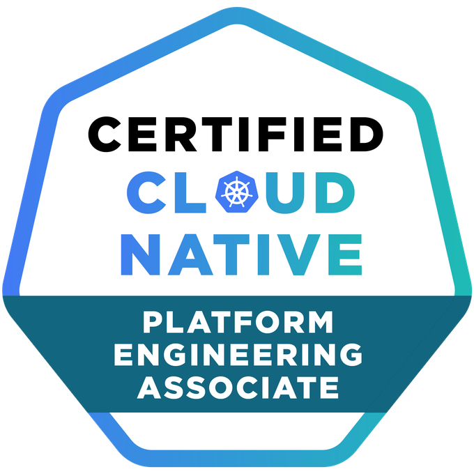
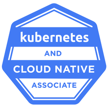
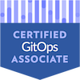
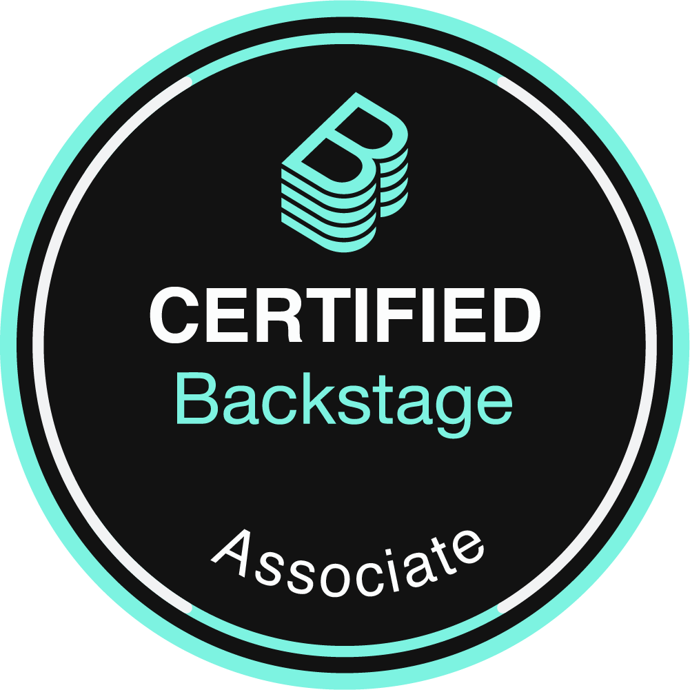
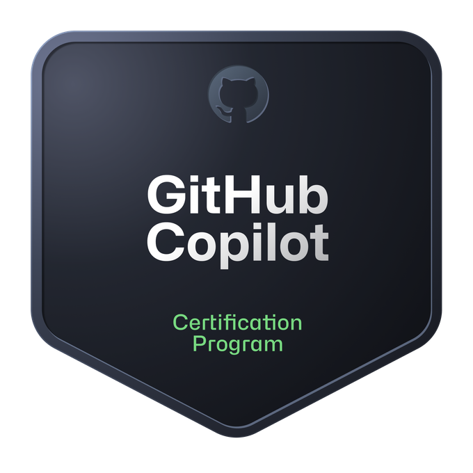
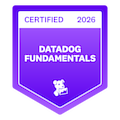
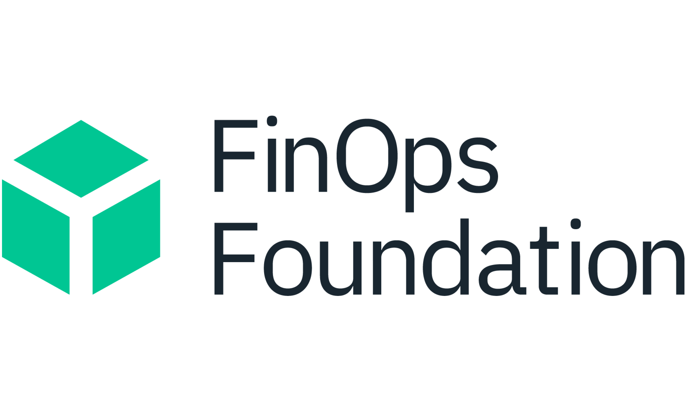

# Hi, I'm Moataz Nabil

**Platform & Quality Engineering Leader.** I build internal developer platforms and quality systems that help engineering teams ship quickly without breaking things.

**Open to:** Head of, Senior Engineering Manager, Engineering Manager, or Staff-level roles in Platform Engineering, Developer Experience, or Quality Engineering · Berlin or remote

📬 [LinkedIn](https://www.linkedin.com/in/moataz-nabil/) · [Blog](https://moataznabil.blog/) · [Twitter / X](https://twitter.com/Moatazeldebsy)

## What I bring

- **Platform engineering:** I designed and open-sourced a complete IDP: Backstage, ArgoCD, Crossplane on EKS, 60 golden-path templates, and an optional AI layer with MCP servers and agents. It runs locally in about 30 minutes.
- **Quality engineering at scale:** test strategy, automation frameworks, quality gates, and metrics for web and mobile teams, now including LLM evaluation and AI-assisted testing.
- **Mobile DevOps:** author of [*Mobile DevOps Playbook*](https://www.amazon.com/Mobile-DevOps-Playbook-accelerating-high-quality/dp/1803242558) (Packt).
- **Teaching and community:** instructor on [Test Automation University](https://testautomationu.applitools.com/instructors/moataz_nabil.html) and conference speaker, most recently at WeAreDevelopers Berlin 2026.

## Featured work

### Platform Engineering & Developer Experience

- **[100 Days of Platform Engineering & DevEx](https://moataznabil.blog/100-days/platform)**: a free curriculum I wrote, with 100 hands-on lessons in 10 phases covering the operating model, golden paths, and the core capabilities of a developer platform.
- **[backstage-platform-template](https://github.com/moatazeldebsy/backstage-platform-template)**: an open-source IDP you can get running with a single `git clone`. It includes Backstage, ArgoCD, Crossplane, EKS, 60 golden-path templates, and AI agents over MCP.
- **[Mobile-DevOps-Playbook](https://github.com/moatazeldebsy/Mobile-DevOps-Playbook)**: companion code for my Packt book.
- **[Appium-Server-GitHub-Action](https://github.com/moatazeldebsy/Appium-Server-GitHub-Action)** (★50+): runs an Appium server inside GitHub Actions for mobile CI.

### Quality Engineering & AI

- **[100 Days of Quality Engineering & Test Automation](https://moataznabil.blog/100-days/qa)**: a free curriculum I wrote, going from QA foundations to quality leadership. It covers test strategy, UI and API automation, contract, mobile, performance, security and accessibility testing, and AI in testing.
- **[copilot-testing-workshop](https://github.com/moatazeldebsy/copilot-testing-workshop)**: GenAI in Testing, a workshop on using GitHub Copilot to speed up quality work without losing trust (WeAreDevelopers Berlin 2026).
- **[qa-engineering-deep-dive](https://github.com/moatazeldebsy/qa-engineering-deep-dive)**: QA Engineering in the AI Era, with 8 modules and 8 runnable labs covering Playwright, k6, promptfoo LLM evals, quality gates, and metrics.
- **[test-automation-practices](https://github.com/moatazeldebsy/test-automation-practices)** (★45): a practice platform with real-world test automation scenarios.

## Tech stack

- **Platform:** Kubernetes, Helm, ArgoCD, Crossplane, Backstage, Terraform, OPA/Gatekeeper
- **Cloud & observability:** AWS (EKS), Prometheus, Grafana, OpenTelemetry, Datadog, FinOps
- **Quality:** Playwright, Cypress, Appium, Espresso, k6, Pact, SonarQube, promptfoo
- **CI/CD & AI:** GitHub Actions, Bitrise, GitHub Copilot, MCP

## Certifications

Certified Cloud Native Platform Engineering Associate (CNPA) · Certified Backstage Associate (CBA) · Certified GitOps Associate (CGOA) · Kubernetes and Cloud Native Associate (KCNA) · AWS Certified Cloud Practitioner · GitHub Copilot · Datadog Fundamentals · FinOps Foundation

  
  
  
  
  
  
  
  

## Writing & talks

- [Talks at conferences and meetups](https://www.youtube.com/playlist?list=PLTgnULQbEpQDsrNfLGfOTCJ--8ovbmata)
- [Test Automation University courses](https://testautomationu.applitools.com/instructors/moataz_nabil.html): Appium, Espresso, TestCafe
- [YouTube](https://www.youtube.com/c/MoatazNabil01) (Arabic, test automation and AWS)
- Articles on [Dev.to](https://dev.to/moataznabil), [Medium](http://moatazeldebsy.medium.com/), and the [Bitrise](https://blog.bitrise.io/author/moataz-nabil) and [Applitools](https://applitools.com/blog/author/moataznabil/) blogs

### Recent posts

<!-- BLOG-POST-LIST:START -->
- [Platform Engineering with AWS: What You Need to Know](https://dev.to/aws-builders/platform-engineering-with-aws-what-you-need-to-know-23b8)
- [Optimizing Test Automation at Scale: Important Metrics and Calculating ROI](https://moatazeldebsy.medium.com/optimizing-test-automation-at-scale-important-metrics-and-calculating-roi-553c2ff66edb?source=rss-22507dab7991------2)
- [Elevating Code Quality: The Power of Static Code Analysis in Modern Software Development](https://medium.com/aviv-product-tech-blog/elevating-code-quality-the-power-of-static-code-analysis-in-modern-software-development-e0316e303afb?source=rss-22507dab7991------2)
- [The key responsibilities of a Software Quality Manager: ensuring high-quality software development](https://dev.to/moataznabil/the-key-responsibilities-of-a-software-quality-manager-ensuring-high-quality-software-development-3a9f)
- [Cloud Test Automation on AWS: The Role of QA Engineers](https://dev.to/aws-builders/cloud-test-automation-on-aws-the-role-of-qa-engineers-4j23)
- [Unveiling my first book “Mobile DevOps Playbook”: Your Handbook for Faster, High-Quality Mobile App…](https://moatazeldebsy.medium.com/unveiling-my-first-book-mobile-devops-playbook-your-handbook-for-faster-high-quality-mobile-app-19affc21ebfa?source=rss-22507dab7991------2)
- [Unveiling my first book &quot;Mobile DevOps Playbook&quot;: Your Handbook for Faster, High-Quality Mobile App 📱🚀](https://dev.to/moataznabil/unveiling-my-first-book-mobile-devops-playbook-your-handbook-for-faster-high-quality-mobile-app-28m3)
- [The Most Beneficial AWS Services for QA Engineers](https://dev.to/aws-builders/the-most-beneficial-aws-services-for-qa-engineers-40f7)
- [Getting started with Appium 2.0: Your beginner’s guide](https://dev.to/moataznabil/getting-started-with-appium-20-your-beginners-guide-3m32)
- [Getting started with Maestro: The new mobile UI testing framework from Mobile.dev](https://dev.to/moataznabil/getting-started-with-maestro-the-new-mobile-ui-testing-framework-from-mobiledev-2n0k)
<!-- BLOG-POST-LIST:END -->

## Let's talk

If you're building a platform or quality team and want someone who has done both hands-on and as a leader, message me on [LinkedIn](https://www.linkedin.com/in/moataz-nabil/).
